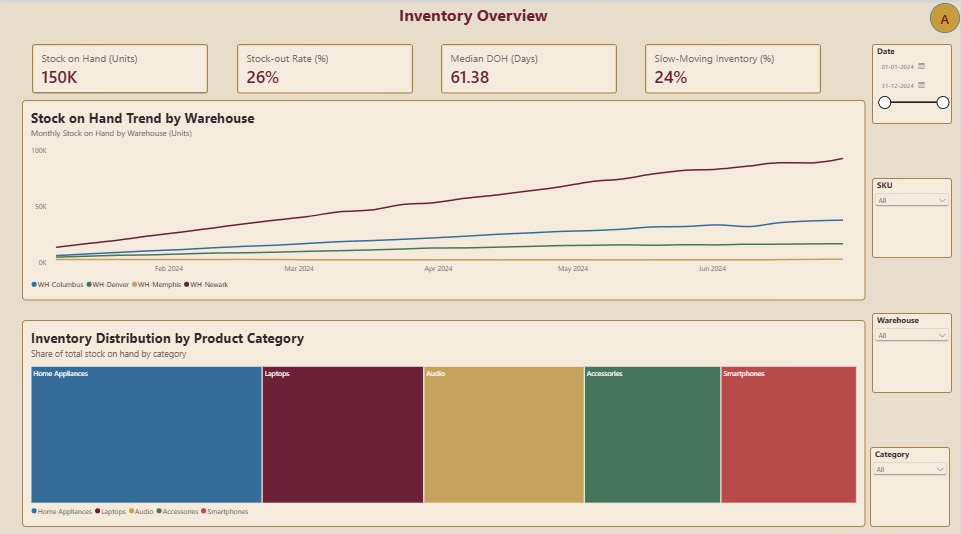
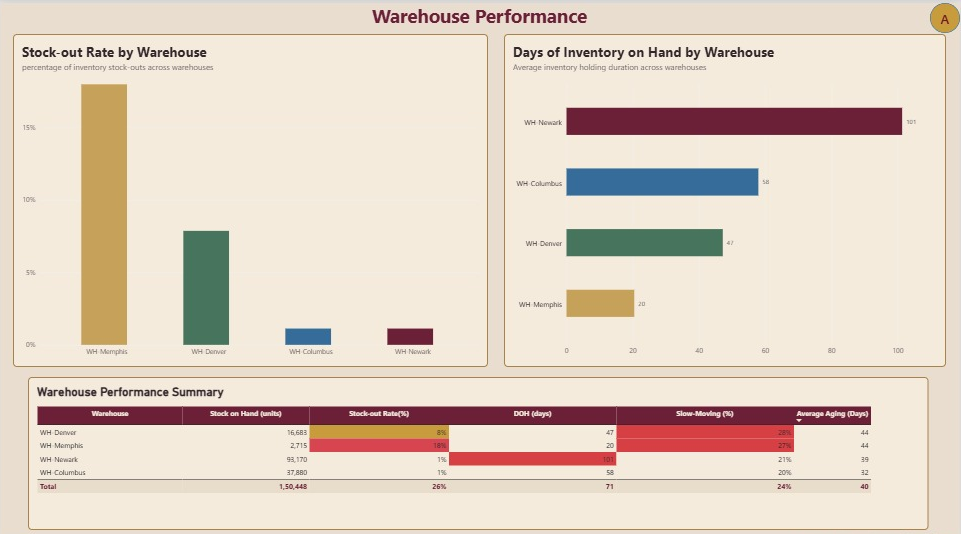
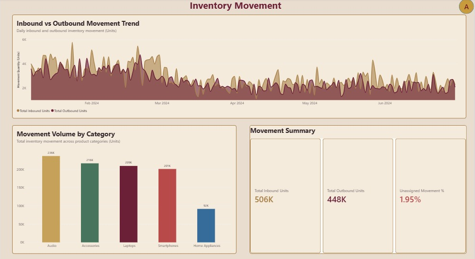
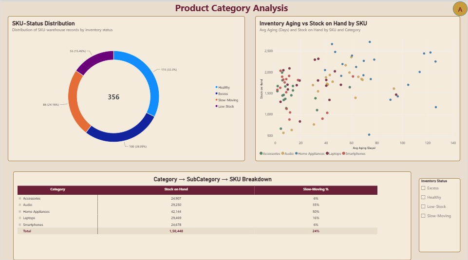
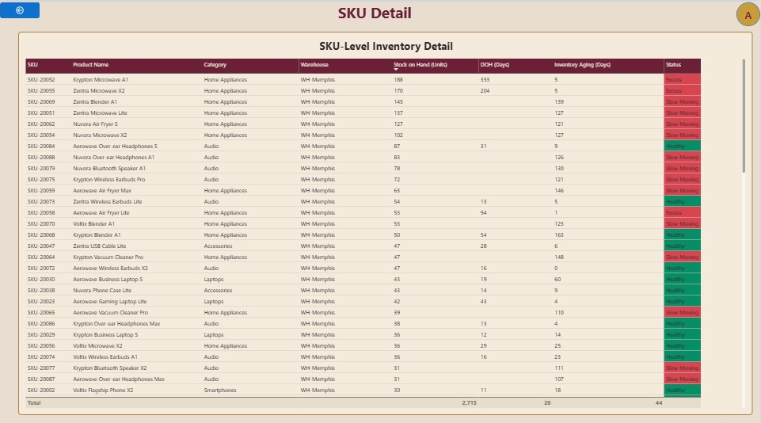

# CircuitHub Electronics: Retail Inventory Analytics Dashboard

**Tools:** Power BI, Power Query, DAX, Excel and CSV sources

> All data in this repository is **synthetic**, created for this project. It contains no client or employer data.

## Business scenario

CircuitHub is a fictional electronics retailer with four warehouses (Columbus, Denver, Memphis, Newark). Each warehouse sends its own weekly stock export, and movements arrive in a separate log. Consolidating them by hand takes days, numbers differ between people, and nobody can see that a SKU is out of stock in one warehouse while sitting unsold in another.

The goal: one consolidated model with consistent, rule-based KPIs and a self-service dashboard for operations.

## What this project covers

- Requirement brief with KPI definitions and business rules (`docs/`)
- Consolidation of six messy source files (1 Excel, 5 CSV) in Power Query
- A model with two fact tables at different grains (stock snapshots and movements)
- DAX for stock on hand, stock-out rate, days of inventory, inventory aging and SKU status
- A five-page report with drill-down, drill-through, synced slicers and conditional formatting

## Dashboard

**1. Inventory Overview**



**2. Warehouse Performance**



**3. Inventory Movement**



**4. Product Category Analysis**



**5. SKU Detail** (drill-through from Warehouse Performance or Category Analysis; shown here filtered to WH-Memphis)



## Key findings (from the sample data)

- **Memphis** has chronic stock-outs: about 18% of SKUs at zero stock, with about 20 days of inventory.
- **Newark** is the opposite problem: about 1% stock-outs, but about 101 days of inventory and about 62% of all stock.
- **Home Appliances** has the largest slow-moving share (about 50% of SKU-warehouse positions) and the lowest movement volume.
- The same SKU can be Low-Stock in one warehouse and Excess in another, which a combined view hides.
- About 2% of movement records have no warehouse code. They are kept and labelled Unknown, not deleted.

The sample data was generated with deliberate contrasts between warehouses and categories, so these findings illustrate what the dashboard surfaces. They are not real business results.

## Data model

```
              Dim_Product
             /     |      \
   Fact_Snapshot   |   Movement_Log
             \     |      /
             Dim_Warehouse      DateTable (to both facts)

SKU_Status_Snapshot (calculated, SKU x Warehouse) -> Dim_Product, Dim_Warehouse
```

Snapshots (a balance at a point in time) and movements (events) have different grains, so they are separate fact tables that share dimensions and are combined only inside measures.

## KPI definitions

| KPI | Definition |
|---|---|
| Stock on Hand | Latest snapshot quantity inside the selected date range |
| Stock-out Rate | SKUs with zero stock at the latest snapshot divided by total SKUs |
| Days of Inventory on Hand | Stock on Hand divided by average daily outbound over the last 30 days |
| Inventory Aging | Days since the last inbound receipt |
| Slow-moving | No outbound movement in the last 60 days |
| SKU status | Slow-Moving, else Low-Stock (under 10 days), Healthy (10 to 60 days), Excess (over 60 days) |

## DAX highlights

```dax
Stock on Hand = 
VAR LatestSnapshotDate = CALCULATE(MAX(Fact_Snapshot[SnapshotDate]), ALLSELECTED(Fact_Snapshot))
RETURN CALCULATE(SUM(Fact_Snapshot[Quantity]), Fact_Snapshot[SnapshotDate] = LatestSnapshotDate)

SKU Status = 
VAR DOH = [Days of Inventory on Hand]
RETURN SWITCH(TRUE(),
    [Slow-Moving Flag] = "Slow-Moving", "Slow-Moving",
    ISBLANK(DOH) && [Stock on Hand] = 0, "Low-Stock",
    ISBLANK(DOH), "Excess",
    DOH < 10, "Low-Stock",
    DOH <= 60, "Healthy",
    "Excess")
```

More measures are described in `docs/CircuitHub_Inventory_Dashboard_Blueprint.md`.

## Data preparation (Power Query)

- Four snapshot files with different column names (`SKU_Code`, `Product_ID`, `SKU`, `Item_Code`) standardized to one schema, with a warehouse column added before appending
- Mixed date formats parsed explicitly instead of relying on the machine locale
- Blank SKU codes removed; blank warehouse codes kept as Unknown
- Duplicate rows removed; ten spellings of movement type standardized to Inbound and Outbound
- Row counts after cleaning: 9,164 snapshot rows, 16,691 movement rows

## Validation, and issues found and fixed

Stock on Hand and warehouse-level figures were reconciled to the source files. Testing also found and fixed:

- **SKU status at the wrong grain.** Blended across warehouses, no SKU could ever be Low-Stock. Status is now calculated per SKU and warehouse.
- **Slow-Moving % showing 100%.** A filter did not travel back across a single-direction relationship; numerator and denominator now come from the same table.
- **Trend chart showing one point.** The Stock on Hand measure always returns the latest date, so the trend uses a separate plain-sum measure.
- **Blank days of inventory treated as Low-Stock.** In DAX a blank compares as zero. Blanks are now handled explicitly.
- **Unknown warehouse showing as (Blank) in the slicer.** An Unknown member was added to the warehouse dimension.
- **Mean days of inventory (about 160) skewed by outliers.** The SKU-level KPI uses the median (about 61).
- **Duplicate snapshot rows** inflating the trend chart in some weeks.

## Known limitations

- SKU status and aging are calculated at the latest data point, so the date slicer does not change them.
- The overall stock-out rate (about 26%) means SKUs out of stock in at least one warehouse, not the average of the four warehouse rates.
- Data is synthetic and the refresh is a manual file drop; there is no automated ingestion.

## How to open

1. Install Power BI Desktop (free).
2. Open `CircuitHub_Inventory_Dashboard.pbix`.
3. To refresh, go to Home, Transform Data, and point each source to the matching file in the `data/` folder.

## Repository structure

```
README.md
CircuitHub_Inventory_Dashboard.pbix
docs/          requirement brief and technical blueprint
data/          six synthetic source files (1 Excel, 5 CSV)
screenshots/   report pages
```

## Contact

Mirza Afzal Baig | [LinkedIn](https://www.linkedin.com/in/afzal-analyst) | mirzadaafzal@gmail.com
